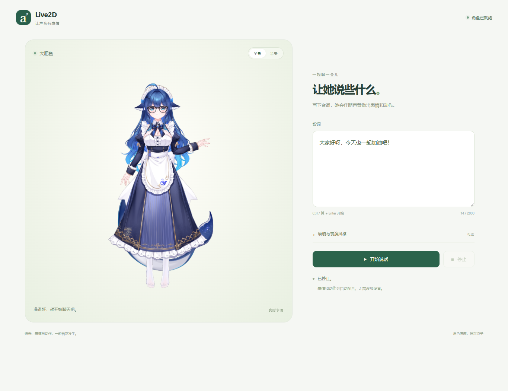

# Auto Live2D

输入台词，让角色伴随语音做表情和动作。未来由 **DeepSeekharness（DSH）** 提供台词；语音继续使用本地 **Qwen3-TTS / da_fei_yu**。

当前默认模型包为 `vtuber-v6-native28-motion-r2`，运行时 `v6.3.2-feedback-acting`。28 维情绪分别保留快响应和慢心情，表情直接读取混合曲线；轻量动作头在实际开口后读取当前情绪与纯动作历史，一次选择协调手势或独立身体动作。默认活泼。28 种情绪已有独立面部形变和身体表现配方，支持眯眼、单眼 wink、撅嘴鼓腮及前倾轻扭；7 个手势意图、6 身体原语仍共用一个调度器（招呼因缺少掌心翻转绑定，暂用点头倾身）。Qwen TTS 音色不变，神经模型全部在 GPU。



角色为免费练习模型“大肥鱼”，**原画：神宫凉子**。本仓库不包含角色原始素材与 PSD。

## 使用

```powershell
python main.py
```

打开 <http://127.0.0.1:8765/>，输入台词，点击 **开始说话**。首次点击同时启用声音；**停止**中断当前发言。支持 Ctrl / ⌘ + Enter 开始，可切换全身或半身预览。

展开“语境、风格与试演”，可以直接试演 28 种情绪或左右 wink、眯眼笑，无需输入台词。默认“活泼”保留完整的连续背景头身幅度，手势与身体动作分别采用 4 秒和 2.6 秒的最短间隔；也可以选择“自然”或“克制”。协调关节曲线、语义门槛、原音色与原生物理沿用现有方案。

保持启动终端运行，按 **Ctrl+C** 关闭全部服务。另一个终端也可执行 `python main.py --stop`。不自动打开网页用 `python main.py --no-browser`；`start.cmd`、`start.ps1` 使用同一入口。日志和进程记录位于 `.runtime/`。

## 当前运行链路

- [Horizon-Labs/multilingual-emotions-base](https://huggingface.co/Horizon-Labs/multilingual-emotions-base) 默认在 GPU 上以 FP32 输出 28 类独立情感分数。28 条证据各自驱动持续面部形变与叠图，自动 wink 仅保留得意场景，按短语观测、随实际音频推进，不因逗号重启 TTS；不再合并六类、不做总和归一化。
- 当前 Qwen3.5-0.8B 编码器保持冻结；两个轻量分支（事件头已重训，连续头复用）：事件分支选择目录动作、变体、力度与时机，连续分支只生成头/躯干/注视背景轨迹。两者都消费 28 维情绪状态与文本语义特征。
- 动作目录保留 none、7 个内容手势和6 个身体原语。28 套情绪配方调整面部形变及已选身体动作；调度器统一处理导演优先、最小间隔、同名去抖、过渡与收势，不恢复旧 27 个情感短段。
- Qwen3-TTS 音色与 CUDA Graph 方案继续使用。400 字以内（Qwen3-TTS 单次合成上限）的已知台词合成一次，标点不反复重启；多个表演计划跟随同一音频时钟。长文按预算拆分，播放时预取下一组。
- Windows Node 提供网页与会话 API（8765）；WSL 动作服务（8768）和 TTS（8769）由统一启动器管理。

旧预测/语音面板、参数实验台、手动动作面板和历史评分入口已移除。日常服务不再提供 `/api/latent/*`、`/api/speech/*`，也不再支持 `--legacy`、`--semantic` 或自动回退。v3 整段动作头、Flow、旧门控和九类手势选择器不再随默认模型加载。历史数据、评分和研究代码保留作研究记录。

现有模型包的训练与验证见 [r2 报告](experiments/vtuber-v6-native28-motion-r2/REPORT.md)，架构见 [原生情绪与动作](docs/emotion-native.md)。旧 27 情绪动作与预览仅归档在 `research/emotion-catalog-r1-archive/`，不进入默认运行。

情绪曲线、概率与表达强度的区别，以及借鉴 SoulLink 的范围见 [连续情绪说明](docs/emotion-curves.md)。

## 外部调用与 DSH

外部程序使用 `POST /api/command`，角色页面需保持打开并先通过用户点击启用声音。整段台词只需建立会话后一次提交：

```json
{"method":"performance.start","params":{"context":"和观众日常聊天"},"request_id":"start-1"}
{"method":"performance.finish","params":{"session_id":"上一步返回的ID","seq":0,"text":"大家好呀，今天也一起加油吧！"},"request_id":"finish-1"}
```

增量文字使用 `performance.append`；结束使用 `performance.finish`，打断使用 `performance.cancel`。模型候选与动作后端由服务固定，不需要调用方选择。人工导演与持久外观使用当前 `performance.direct` 和 `appearance.update`。

完整客户端见 [`examples/performance_demo.py`](examples/performance_demo.py)，接口见 [会话 API](docs/performance-v4.md)与[工具 Schema](docs/performance-tools.json)。

## 本地资源与环境

公开仓库包含自研代码、说明、测试与实验元数据。运行还需要本机资源：

| 资源 | 准备方式 |
| --- | --- |
| Live2D Cubism SDK for Web 5 R4 | 从官方 SDK 包提取 `Core/`、`Framework/`、`LICENSE.md` 到 `vendor/cubism/`；来源见 [第三方说明](THIRD-PARTY-NOTICES.md) |
| 大肥鱼角色 | 从原作者处获取，保持模型目录与文件名，放在 `live2d/DeepSeek/DeepSeek/`；禁止再分发原始 PSD |
| Qwen3.5-0.8B 权重 | 运行 `latent/prepare_encoder.py`，按固定来源下载到 `models/`；当前推理不需要 4B |
| 多语言情感模型 | 运行 `python latent/prepare_emotion.py`；固定来源与 SHA-256 见 `latent/emotion-source.json` |
| 当前表演检查点 | `experiments/vtuber-v6-native28-motion-r2/{continuous.pt,event.pt}`，事件头由 `latent/train_motion_r2.py` 产出，连续头按原字节复用；`latent/stream-run.json` 指向当前包，通道契约是 `latent/runtime-profile.json` |
| Qwen3-TTS 与 da_fei_yu 音色 | 推理源码固定副本在 `vendor/qwen3-tts/`；微调权重放在 `models/Qwen3-TTS-12Hz-1.7B-da_fei_yu/`；`speech/config.json` 只需设置该目录与 `python` 环境路径；加速源码在 `vendor/faster-qwen3-tts/` |
| 本地资产自检 | `python scripts/verify_local_assets.py` 逐文件校验全部运行时模型与源码副本，无需网络；布局与已释放的 HF 缓存见 [本地资产](docs/local-assets.md) |

需要 Windows 10/11、Node.js ≥ 22.12、Python 3.12+、WSL2 `Ubuntu-24.04`、WSL 内的 uv/Python 3.12、独立 Qwen3-TTS conda 环境、NVIDIA CUDA 与支持 WebGL 的浏览器。首次运行 `npm ci`。动作环境由启动器在 WSL 文件系统内管理；TTS 环境路径在 `speech/config.json` 的 `python` 字段。

在 WSL 中准备编码器：

```bash
cd /mnt/d/Workplace/auto-live2d
export UV_PROJECT_ENVIRONMENT=$HOME/.local/share/auto-live2d/latent-venv
uv run --project latent python latent/prepare_encoder.py
uv run --project latent python latent/prepare_emotion.py
```

服务默认只监听 `127.0.0.1`，运行时需要浏览器保持角色页面打开。训练数据、历史快照和大模型权重不随公开仓库分发；训练复现另见 `latent/README.md`。本地路径应按实际目录调整。

## 开发与验证

```powershell
npm run dev
npm test
npm run build
python -m unittest tests.test_default_launcher -v
# 情感模型与 v6 契约（WSL）：
uv run --project latent python -m unittest latent.test_emotion -v
uv run --project latent python -m unittest latent.test_emotion_catalog -v
# 表演和 TTS 服务已启动后，在独立端口验证生产页面：
npm run test:browser
npm run test:continuous
# 长文预取与衔接（同样使用真实GPU服务）：
npm run test:continuous -- --long
```

浏览器检查覆盖真实语音、角色渲染、单页开始/停止、音频暂停/恢复、导演指令、取消、28 维曲线和移动端。本轮记录在 `test-results/native28-refactor-r2/`，旧 v5/v6 数据保留作历史。历史冻结清单对应原源码，不能当作当前开发树的哈希验证结果。

## 许可

自研代码与实验产物采用 MIT，见 [LICENSE](LICENSE)。Cubism、Qwen、角色素材等第三方资源的来源与许可见 [THIRD-PARTY-NOTICES.md](THIRD-PARTY-NOTICES.md)。

情绪表现的设计表、导演调用与验证边界见 [情绪表现设计](docs/emotion-acting.md)。

新增独立 [表演评分页](http://127.0.0.1:8765/review)：同一份语音对比 A/B/C 候选，明确选择后保存本地偏好；内置 100 条练习，不自动训练。使用与数据格式见 [偏好采集说明](docs/preference-review.md)。

手势力度与手型图层切换已分开，修复弱力度举手、指点、持草时的半透明叠影，见 [手部渲染修复](docs/hand-drawings.md)。

首轮 99 份人工评分及眼神/手型修订见 [反馈处理记录](docs/review-feedback.md)。
