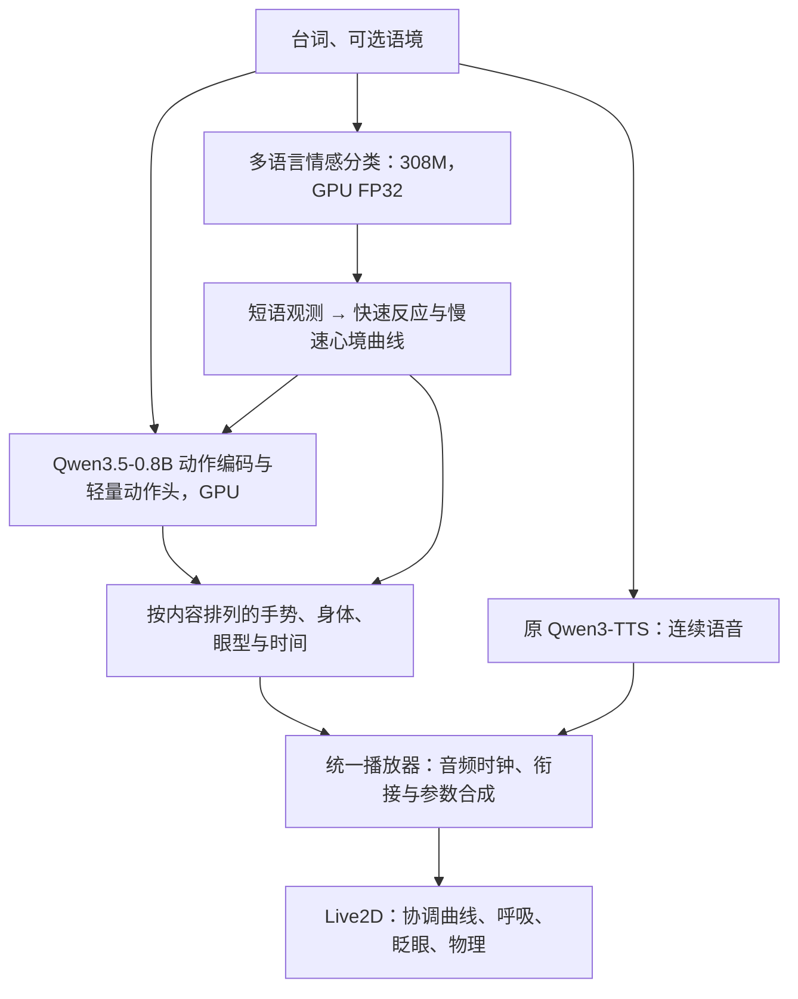

# 情感分类与动作模型架构

当前运行时为 `v5.1.0-emotion-curves`，默认权重包仍是 `experiments/vtuber-v5-emotion-action-r1`，由 `latent/stream-run.json` 指定。按用户要求，默认运行链路已移除 Qwen3.5-4B 规划器及依赖它的身体分支。DSH 未来只负责提供台词；目前尚未接入 DSH。



## 模型职责

| 模块 | 输入与输出 | 实现 |
| --- | --- | --- |
| 情感分类 | 当前短语 → 28 个独立分数 → 多情绪表达目标 | [`latent/emotion.py`](../latent/emotion.py) |
| 连续情绪 | 音频播放位置与短语观测 → 快速反应、慢速心境、混合权重与显式 VAD 映射 | [`src/emotion-curve.ts`](../src/emotion-curve.ts) |
| 动作模型 | 台词、语境、角色历史、音频特征及情绪条件 → 协调动作选择与连续背景轨迹 | [`latent/emotion_action.py`](../latent/emotion_action.py)、[`latent/streaming.py`](../latent/streaming.py) |
| TTS | 完整语音单元 → 流式 PCM、嘴部和韵律特征 | [`speech/runtime.py`](../speech/runtime.py) |
| 会话服务 | 文本排队、并行准备、一个单元的预取、取消 | [`server/performance-service.ts`](../server/performance-service.ts) |
| 播放器 | 一个音频流上执行多个表情/动作计划，维护连续姿态 | [`src/performance.ts`](../src/performance.ts)、[`src/speech.ts`](../src/speech.ts) |

情感模型为 [Horizon-Labs/multilingual-emotions-base](https://huggingface.co/Horizon-Labs/multilingual-emotions-base)，固定 revision `4f95ad28e89def7cce33b0589de4ed369b970deb`。本地实际参数量 307,551,772；使用 sigmoid 多标签输出及作者发布的各标签阈值。来源、文件 SHA-256 和本地目录由 `latent/emotion-source.json` 记录，只加载本地 safetensors，不执行仓库中的远程 Python 代码。

模型原始分数、采用阈值和渲染强度分别保存。每个短语保留 28 个 sigmoid 分数，按标签阈值形成连续表达目标，组内取最大证据以避免类别数量偏差。播放端以较快反应和较慢心境维护混合权重；主情绪标签仅作带迟滞的摘要，不负责清空其他曲线。当前分类器置信分数并非真实情绪强度的量尺，VAD 也是显式投影，而非该模型直接预测。详见 [连续情绪说明](emotion-curves.md)。

普通情感表情由连续层统一拥有，背景动作模型不能用整段文本的预测抢先笑或皱眉。动作模型读取同一实际播放状态的混合权重；显式导演覆盖表现，但不改写自动心境，释放后平滑回到当前情绪。

默认情绪输入排除引号内文本，避免把朗读的他人情绪当成角色本人情绪；动作模型和 TTS 仍读取原台词。这个规则是明确的引用范围策略，不是对反讽或说话人归属的完整语义理解。模型训练数据与公开阈值也不等同于本角色中文直播场景的人工校准。

动作侧继续使用当前 0.8B 编码器和回归轨迹专家，并复用已训练的轻量动作头选择手势、身体、眼型和时间；检查点来源分别为 `v4-default-r1` 与 `v4-composition-r2`，记录在新包的 `run.json`。旧动作头的情绪输出被分类器替换，分类结果通过动作模型已有的情绪条件输入影响头身表现。此次未重新训练动作网络或音色，也没有将旧评分当成本方案的自然度验收。

## 语音分组与动作分段分离

已知文本在 240 字以内时合成一个语音单元，逗号、句号和问号不重新启动 TTS。长文本按当前动作编码预算在自然句边界附近拆分；增量输入在完整句结束、明确 flush、长度上限或 finish 时提交，逗号不单独提交。

每个语音单元仍可包含多个语义句。动作计划按语义句准备，情感则可细分到逗号等短语边界，并保护引号范围；情感与动作的模型输入在同一预热批次准备。连续轨迹更新只用缓存的 0.8B 特征、小型解码器及当前已平滑的情感权重，约每 400 ms 更新一次。不会在每次轨迹更新中重复分类或重复规划，也不为新增情感观测创建 TTS 音频。

浏览器的 `performance.utterance` 在同一个 speech_id 上注册动作计划与独立情感观测。语义句和短语按原文字符位置占比近似对应音频进度；TTS 给出最终样本数后修正未触发的时间点，已经执行的事件不会回退或重放。当前没有逐词或音素级对齐。停顿、缓冲与暂停不会推进情绪，预取也不提前写入心境。跨句、跨音频单元保留现有曲线，正常结束后缓慢衰减，明确取消则清理未来观测与心境。

当前音频合成完、但还在播放时，会预先准备下一个语音单元，并持续读取其 PCM 到有界缓冲。只有轮到播放时才提交浏览器。最多预取一个单元；取消同时停止当前语音、推理、待播音频和未来动作。

嘴部和动作使用 AudioContext 的实际播放进度；暂停或断流不靠墙钟追赶。原生手臂曲线、单手协调、特殊眼型互斥、呼吸、眨眼与物理继续生效。默认风格仍是“活泼”。

## 准备与运行

```powershell
python latent/prepare_emotion_action.py
python main.py
```

准备脚本下载并校验固定情感模型，复用新包元数据中列出的两个动作检查点，不进行训练。已有资源只验证：

```powershell
python latent/prepare_emotion_action.py --verify-only
```

动作与 TTS 仍由标准启动器统一管理。网页在 8765，动作服务在 8768，TTS 在 8769；情感分类器、动作编码器、动作头及 TTS 默认均使用 CUDA，情感分类器保留 FP32 精度。BF16 在已验证的中文害羞样例中改变了类别，因此本次只迁移设备，保留原有数值精度。启动器的 `--device` 统一传递给各模型，不再单独固定情感分类器到 CPU。缺失或错误的模型文件会明确失败，不回退加载 4B。

外部调用仍使用 [会话 API](performance-v4.md)。日常 UI 保持角色、台词与开始/停止，语境和风格折叠。旧预测/语音 HTTP 接口和启动回退继续移除。

进一步去掉 0.8B 时，需要为情感编码器的 768 维表示重新训练或蒸馏动作头；本次没有把它直接填进要求 1024 维语义特征的旧动作网络。
