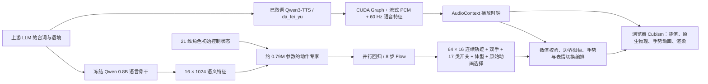

# 当前主线架构

上游 LLM 不在本项目内训练。当前用网页输入模拟它的输出。Qwen 的语言骨干只提特征，参数全冻结；动作专家为新训练的小网络。它直接回归整段轨迹，或预测噪声到动作的条件向量场，未增加动作 VAE。

连续控制层输出 16 个独立驱动参数。大量辅助、网格或物理输出参数由 Cubism 联动；左右手、17 类表情/外观开关、3 种体型和原生动画选择另外学习。这些等效控制覆盖 23 个可见选项与 8 个原始动画，完整 509 参数接口仍保留。

双手状态由分类头逐时刻预测，再调用已有进出动画；手臂动画曲线本身未重新生成。表情头以多标签 BCE 学习每个时刻的开关，眼型做互斥，原始 exp3 渐变执行。并行头一次前向输出全段，Flow 用 8 次 Euler 更新；两者分别训练。

体型头逐时刻预测 default/preset1/preset2；联合训练后仅用 train 的平衡采样修正该分类器，其余网络权重不变。完整“脱捕”由独立分类头选择，播放 13.8 秒原始动画并暂停生成轨迹的执行，避免两套驱动覆盖。它是原生动作选择，不能算作新生成的曲线。

随后用 train 中的前倾配置继续训练连续解码器，提高稀有大幅前倾目标的采样率。此阶段冻结语义投影、时间查询及所有分类头；普通对话的表情与手势判定保持不变。

呼吸、自动眨眼、IDLE 和物理始终在普通动作底层运行。单独的背景时钟跨动作复位保留；自动眨眼在动作眼睑目标之后取最小开度，因此预测睁眼不会禁用背景眨眼。录制另存叠加眨眼前的 action_driver，学习不会把同一次自动眨眼叠加两遍。

Windows Node 服务监听 8765，提供页面、模型资产、HTTP 和 WebSocket。WSL Python 服务监听 8768，只负责神经推理。WebSocket 将控制指令送入单个角色页面；实际物理与渲染固定 60 Hz。后台模型任务不占用渲染循环。

`python main.py` 在 Windows 终端前台管理整个运行周期。Windows Job 管理 Node/构建子进程，WSL 控制进程管理动作专家与 TTS 的独立进程组。Ctrl+C、启动取消、控制管道断开或服务失败均进入统一清理；退出后释放端口和模型显存。WSL 宿主会把共享控制台输入切到原始模式，使终端的 Ctrl+C 不再转成控制事件；启动器在等待服务期间持续恢复 `ENABLE_PROCESSED_INPUT`，并监听原始 `0x03` 字节兜底，退出时恢复原模式。入口不接管已有服务；单实例锁防止重复启动。`--stop` 通过本项目会话标记请求原启动器清理，并核对 PID 与创建时间。

语音服务独立监听 8769，复用训练环境和 da_fei_yu checkpoint，使用固定版本 CUDA Graph 推理。语音与语义动作并行准备；真实 PCM 分块传给单个角色页面，首段即播放，无需等待整句。AudioContext 是嘴部、生成轨迹进度和语音重音层的共同媒体时钟；长句伸展生成动作，完整原始脱捕保留自己的速度。缓冲不足时媒体进度保持，暂停后从原样本续播，取消请求会停止解码。最终 WAV 与已传输的 PCM 样本相同。

实际 PCM 产生因果嘴部开合、平滑能量与间隔至少 550 ms 的重音；头部与滞后 90 ms 的躯干小幅联动。该层在普通动作之后、物理之前合成，不增加手部或表情开关；情绪嘴形仍来自语义动作。它是信号处理与播放逻辑，尚无音素对齐或音频到动作联合训练，没有改动冻结训练集、动作检查点或 TTS 训练项目。完整 prepare/execute 接口保留，CPU 使用原完整合成路径。

`/api/latent/predict` 返回真实数值轨迹和可执行命令，缓存一份短期预测；`/api/latent/execute` 消耗该预测，先复位，再播放。预览页面无需执行即可检查数值。预测携带数据/模型哈希；录制保留模型来源，避免模型生成片段混入人工示范。

当前只有默认初始姿态监督，因此执行入口明确复位。若已有未保存录制，便捷执行接口拒绝覆盖它。后续增加跨段状态训练后，才能取消默认复位并实现滚动动作块控制。
