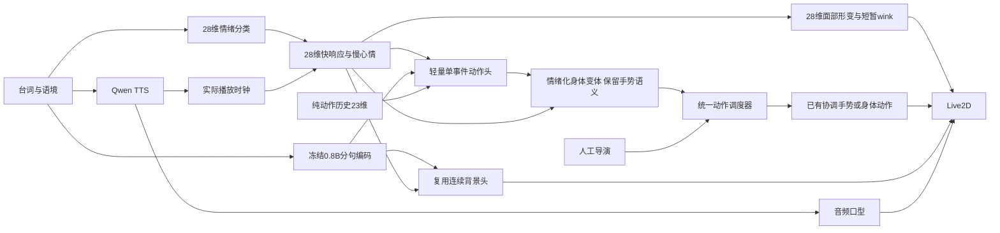

# 当前架构

`v6.3.2-feedback-acting`默认包为 `experiments/vtuber-v6-native28-motion-r2`。

预取不决策动作；开口后按实时状态规划。表情直接读取快慢混合曲线，动作只保留一个所有者。缓冲和暂停共用零增量，空闲继续收势。全部神经网络在GPU；情绪分类器用FP32，0.8B及Qwen语音沿用现有精度。没有4B、旧情绪别名或旧计划适配。

Node会话API：8765；WSL模型服务：8768；Qwen语音：8769。主界面仅保留预览、台词、开始/停止，语境、风格和情绪试演折叠。未来DeepSeekharness通过会话API提交台词即可；本轮只留边界。

契约、动作扩展边界见 [原生情绪与动作](emotion-native.md)，外部调用见 [会话API](performance-v4.md)。

具体形变、时序、身体配方与训练边界见 [情绪表现设计](emotion-acting.md)。模型包继续使用 r2；本次只修改运行时表演，不重训网络。

独立 `/review` 页面调用同一个表演运行时，复用固定语音、记录实际执行并保存人工偏好；不加载额外模型。见 [表演偏好采集](preference-review.md)。

最终组合阶段对手臂替换图层执行离散互斥处理；手势力度仅改变连续关节，见 [手部渲染修复](hand-drawings.md)。
