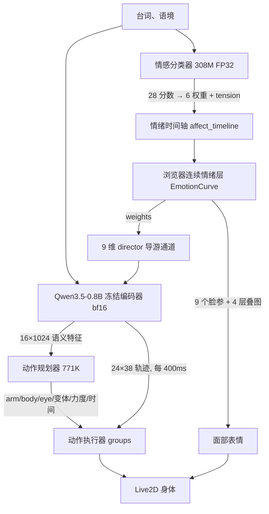

# 情绪优先结构：0.8B 动作模型与情绪模块的重叠分析

> 本文是 2026-11-05 的分析记录，用于解释 v5 链路的重叠来源。最终实施的 v6 方案见 [情绪原生表演](emotion-native.md) 与 [架构说明](architecture.md)：保留 0.8B 作为纯动作编码器，28 维原生情绪驱动持续表情，当前 17 个动作选择由统一目录/调度器执行，早期 27 个情感短段已经归档，两个动作小头以真实 28 维状态为条件重训。本文的 R0/R1/R2 路线只保留为决策依据。

状态：**分析提案，未实施**。基于 `e4c3a3d` / 运行时 `v5.1.0-emotion-curves` / 模型包 `vtuber-v5-emotion-action-r1`。本文只读代码与既有实测，没有改动运行时行为、权重或测试。

## 0. 先给结论

1. **Qwen3.5-0.8B 现在不是情绪模型。** 它默认链路里真正生效的输出是：每句一次的动作选型（手臂/身体/眼型/变体/力度/保持/起始）、以及每 400 ms 一条 24 帧 × 38 通道的连续全身轨迹。它的情绪头与表情头仍在计算，但结果被丢弃。
2. **你感觉到的重复是真实的，但位置不在"两个模型都在算情绪"，而在"同一句话被两个模型各读一遍"以及 v5 接入时留下的 6 处接线接缝。** 其中 4 处删掉不需要训练，也不会损失当前表现。
3. **"文字 → 情绪 → 身体"按字面不成立。** 6 维情绪决定不了"挥手 / 指 / 解释 / 拒绝 / 道谢"，也决定不了"何时开始、持续多久"。情绪是"怎么动"的调制，动作语义是"做什么"。强行把身体只接到情绪上，角色会从"会表演"降级为"情绪氛围人偶"。
4. **优雅的等价式是：文字只读一次 → 一个显式情绪状态（唯一的情绪权威）→ 身体（动作意图 + 情绪条件 + 韵律）。** 情绪仍然只有一处产生、一处拥有；动作模型只消费它，不能自己再产生情绪标签。
5. **如果想只留一个文本模型，应该先做一个探针实验来选编码器，而不是直接删 0.8B。** 两个合并方向的训练量和风险不对称：留 0.8B 要蒸馏情绪头（改情绪来源，需重校准）；留情绪编码器要重训动作头（改动作来源，需重验动作质量）。代码、数据和评测脚本都现成，半天到两天就能得到答案。

## 1. 当前默认链路



两个模型的实测画像（同一次真实浏览器会话，见 `test-results/emotion-action-v1/after.json`）：

| 项 | 情感分类器 | 0.8B 动作链路 |
| --- | --- | --- |
| 模型 | ModernBERT 多语多标签，307,551,772 参数，FP32 | Qwen3.5-0.8B，bf16，1.67 GB 权重，冻结 |
| 调用粒度 | 每语音单元 1 次批量前向 | 整句预热 1 次 + 每个语义句 1 次 |
| 实测成本 | 47.5 ms（批 2）/ 87.9 ms（批 9，`emotion-probe.json`） | 39.2 ms / 48 token；400 ms 轨迹更新命中缓存后 5.6–6.2 ms |
| 输出 | 28 个 sigmoid 分数 → 阈值证据 → 6 维权重 + tension → 曲线 → 9 个脸参 + 4 层叠图 | 每句动作计划（7 手势 × 3 变体、6 身体 × 3 变体、5 眼型、4 个时间量）+ 24 帧 × 38 通道轨迹（20 Hz，1.2 s 前瞻） |
| 情绪相关 | 全部 | 只通过 director 9 维与 face_state 12 维进入解码器；规划器只拿 dominant 标签与当前脸态 |
| 显存 | ≈1.15 GB | ≈1.67 GB，另加 2.5 MB 回归头与 3.1 MB 规划器（0.62M / 0.77M 参数） |

首音时序有一个容易忽略的事实：**prefill（分类 + 编码 + 规划）是硬闸门**。TTS 的 NDJSON 事件流要等 `ready` 才放行（`server/audio-stream.ts:12-13`），浏览器要等 `prepared` 才收到 `start`（`server/performance-service.ts:138`）。所以首音 ≈ max(TTS 首块, prefill) + 两次命令往返 + 100 ms 排程（`src/speech.ts:92`）。当前短句实测首音 1.036 s。也就是说：prefill 里省掉一次 0.8B 编码，在 TTS 较快的句子上会直接变成首音收益；在 TTS 较慢的句子上则只是余量。

## 2. 情绪模块的边界

- **它拥有脸，不拥有身体。** 连续层只写 `EyeSmile / ParamMouthForm / ParamBrowL/R Y / BrowInnerUp / LEyeSquint / REyeSquint / ParamEyeBallY` 九个参数和 黑脸/流泪/脸红/流冷汗 四层叠图（`src/emotion-curve.ts:44-49,112`）。眼型、手势、身体、口型、眨眼/眼皮、衣着、物理都不归它（`docs/emotion-curves.md:22`）。
- **768 维隐表示没有导出。** 分类器只取 logits（`latent/emotion.py:110,123`），要拿隐藏态需要改代码；`docs/architecture.md:69` 已经写明这条路的代价。
- **它是浏览器侧的音频时钟状态。** 快速反应 200/650/240 ms、心境 1.8/3.2 s、混合 0.75，主标签带迟滞；VAD 是显式投影，只用于反向判定与状态展示（`src/emotion-curve.ts:12-13,83-94`）。
- **它的时间与动作模型的时间是两套。** 情绪按短语（Python `emotion_spans`，逗号 ≥6 字、64 字窗口）切，动作按语义句（`server/semantic-clause.ts`）切，都按字符占比近似映射到音频；没有词级对齐。缓冲时情绪冻结，但动作的 `actionMs` 仍走墙钟（`src/performance.ts:229`），长时间缓冲后手势与表情会漂移。
- **它的旧表情通道还在。** `performance.plan.v1` 仍携带 `emotion / expressions / face_hold_ms / emotion_threshold / affect_strength`。默认 `affect.enabled` 为真，这段逻辑被 `performance.ts:200` 短路；只有关掉连续层时才会作为回退生效。

结论：情绪模块是"脸的连续状态机"，不是"动作决策器"。它能当情绪的唯一权威，但当不了身体语义的唯一中间表示。

## 3. 0.8B 的边界

**输入**（`latent/streaming.py:41-45`）：文本 token（chat 模板 + 语境 + 风格，≤512 token，取末 16 个隐状态 ×1024）、音频 24×12（1.2 s 包络/韵律）、38 维当前姿态、20×38 姿态历史、9 维 director、12 维 face_state、4 维运动相位。

**默认生效的输出**：

- 规划器：`arm`（8 类，含 none）、`body`（7 类）、`eye`（5 类）、`arm_variant / body_variant`（3×3）、`body_strength`、`arm_hold_ms / body_hold_ms / onset_ms`、各头置信度；
- 回归头：24 帧 × 38 通道连续轨迹（每 400 ms 更新一次）与 `hold`。

**已经在算但被丢弃的输出**：

- 回归头自己的 7 类 `emotion`、6 脸强度、5 眼型（`latent/streaming.py:36-39,56,208-215`）。它仍随 `/stream/predict` 返回，但默认每句都有 plan，浏览器不采用（`src/performance.ts:163,179-180`）。`experiments/vtuber-v5-emotion-action-r1/run.json` 里 `emotion_accuracy` 0.61–0.70 就是这个头的历史指标。
- 规划器的 `emotion` 头与 12 维 `values` 中的表情分量：`latent/emotion_action.py:53` 用分类器结果覆盖了 `emotion/expressions`，浏览器又因 `affect.enabled` 跳过旧逻辑。

**不可替代的职责**：把文本、语境、音频包络和过去 1 s 的姿态，变成每 400 ms 一条连续的全身轨迹；同时决定"这句话配哪个手势、什么时候起手、保持多久"。7 手势 × 3 变体、6 身体 × 3 变体是手工资产，但"何时、多大、和语音如何对齐"是训练出来的。规划器在同数据上的合成标签准确率：arm 89.9%（召回 73.7%）、body 81.9%（召回 53.8%）、eye 98.7%（`experiments/vtuber-v4-composition-r2/run.json`）。

**可被吸收的职责**：表情强度、眼型、以及"情绪→动作幅度"的调制。这些确实和情绪模块重叠。

## 4. 重复到底在哪：6 处接缝

| # | 接缝 | 证据 | 性质 |
| --- | --- | --- | --- |
| 1 | 同一句话被两个模型各读一遍，两套 tokenizer | 分类器 1 批/单元；0.8B 1+N 次/单元（`latent/emotion_action.py:40-52`） | 真实重复，但属"两模型架构"的必然成本 |
| 2 | 情绪被算三次、表情有两条通道 | 分类器（`emotion.py:87-101`）、回归头（`streaming.py:56,215`）、规划器（`performance_planner.py:12,40`）；plan 表情与连续层 | 历史遗留：删死输出即可 |
| 3 | 情绪进动作模型有 4 条路径 | director 9、face_state 12、weights→director（`emotion_action.py:61-69`）、state 里的脸参 | v5 接线：同一状态四种编码，冗余且分布不一致 |
| 4 | 借道人工导演通道 | 训练时 director 只有 35% 概率是 one-hot（`latent/train_streaming.py:84-85`），推理时喂连续混合权重 | v5 接线：冻结解码器训练/推理分布不一致 |
| 5 | 眼型归属错位 | 爱心眼/圈圈眼/＞＜/屑屑眼是情绪表达，却由规划器的 eye 头选（`performance.ts:208`），脸由曲线层拥有 | 概念不一致：情绪表情被切成两半 |
| 6 | 双切分 + 三时钟 + 单锁 | TS/Python 两套切分阈值；actor/media/motion、affect、AudioContext 三套时钟；`serve.py:31` 一把锁让预取与 400 ms 轨迹互相阻塞 | 工程耦合：预取抖动、边界错位 |

第 2 项是最容易被误读成"0.8B 和情绪模块重复"的地方：检查点里还留着一个 7 类情绪头和一个 6 脸表情头，代码还在算，只是没人用。看到"0.8B 也输出情绪"，就会觉得它和情绪模块撞车。**把它们删掉，"重复感"会消失一半，而当前表现一点不变。**

第 4 项是更深的设计问题：`director` 本来是"人工导演的显式情绪方向"，v5 把自动情绪权重塞进同一个 9 维通道。功能上能跑（`test_emotion.py` 也覆盖了），但接口语义被污染——"自动情绪"和"导演覆盖"共用一个入口，只靠 `director[8]` 的 0/1 区分优先级。

## 5. 为什么"文字→情绪→身体"不能按字面实现

把身体只接到情绪上，需要 6 维权重（+tension）决定下面这些量：

- 手势语义：7 类 × 3 变体。`谢谢大家`→thanks、`你看这个`→point、`不是这样的`→refuse、`我解释一下`→explain，这几句的情绪可能都是 neutral/happy，但手势必须不同；
- 眼型：5 类。爱心眼、圈圈眼、＞＜、屑屑眼，本身是情绪表达，但需要"对谁、对什么事"的语义；
- 时间：`arm_hold_ms / body_hold_ms / onset_ms` 与每 400 ms 的轨迹节拍。情绪曲线给不出"这句话第 3 个字起手"；
- 连续协调：24 通道 × 24 帧的头身轨迹，靠文本 + 韵律 + 历史姿态，不靠情绪向量。

所以字面实现只有两种结果：

1. **氛围化**：身体只用情绪做"幅度/频率/倾向"的连续调制（呼吸、摇摆、头部倾斜、姿态幅度），手势退化成按情绪轮换的固定库。这是可以做的、也更省，但它是一个**不同的产品**：角色会"有情绪地动"，不会"说着这句话做这个动作"。v4 的意图、组合、手势校准、协调曲线基本作废。
2. **偷偷把语义塞回状态**：把"意图/说话行为"打包进状态向量，那它就不再是情绪，而是"表演状态"——绕了一圈又需要文本编码器。

因此，"精简优雅"的正确形式不是"删掉语义通道"，而是：

> **文本读一次 → 一个显式状态（情绪是其中唯一的情感维度）→ 身体（意图选型 + 情绪条件 + 韵律）。情绪只有一个产生处、一个拥有处；动作模型只能消费情绪，不能自己产生情绪标签。**

这与你 README 里"表情和动作共用平滑权重""普通情感表情由连续层统一拥有"的目标是一致的，只是现在代码里还留着两套旧通道，让人看不清边界。

## 6. 三条收敛路线

| | R0 拆接缝 | R1 单编码器双头 | R2 纯情绪→程序化身体 |
| --- | --- | --- | --- |
| 训练 | 0 | 一个头（0.5–2 天，含评估） | 0（但重做动作层） |
| 运行时 | 三个模型不变 | 两个模型（删 0.8B 或删分类器） | 两个模型（分类器 + TTS） |
| 首音 | 不变 | prefill 少 1 遍文本，多数句子上限下移 | prefill 最短 |
| 显存 | 不变 | −1.2 或 −1.7 GB | −1.7 GB |
| 表现 | 不变 | 接近（取决于探针结论） | 语义手势/时间/协调丢失，需重调 |
| 与"文字→情绪→身体"的距离 | 结构上到位，但仍是两模型 | 一个模型，最接近 | 字面最接近，产品最远 |

### R0：拆接缝（建议现在做）

1. `performance.plan.v1` 去掉 `emotion / expressions / face_hold_ms / emotion_threshold / affect_strength`，升 `performance.plan.v2`；v1 仍可解析但字段被忽略。表情只由连续层写。
2. 回归头不再计算/返回 `emotion / face / eye / hold`（`latent/streaming.py:36-39,56`、`latent/emotion_action.py:58-75`）；检查点与 `run.json` 哈希不动，只是不 decode。
3. 规划器不再 decode `emotion` 头；`values` 里只保留动作相关的强度与时间（`latent/performance_planner.py:12,39-43`、`latent/planner_contract.py:10,30-32`）。
4. 把 `director` 明确拆成 `affect_guide` 与 `director`（或至少在命名、文档、校验上区分）；`face_state` 只保留"当前脸态"语义，不再重复承载情绪。
5. 眼型归属二选一并写进契约：要么"眼型属于动作"（保留规划器选眼型，但不再假装它是情绪表情），要么"眼型属于情绪"（曲线层按权重/ VAD 选），不能两边都管。
6. 统一切分器（TS 与 Python 共用一个 contract），或至少把两套阈值对齐到同一个定义。
7. 消除第三套时钟：`EmotionCurve` 用播放器的 `actionMs` 推进，而不是自持 `nowMs`；缓冲时与动作一起冻结。
8. 锁拆分：prefill 与 400 ms predict 分队列，或把分类/编码移到独立 worker，避免预取抖动。

R0 不改表现、不改权重，只改契约与死代码；它把"谁的字段""谁拥有表情"变成可测试的断言。风险主要在外部 API 兼容（DSH 尚未接入，可以版本化）。

### R1：单编码器双头（建议作为主方向，但先做探针）

```
文字 ──► 一个编码器 ──► 语义特征 ──┬──► 情绪头 → 28 分数 → 曲线 → 脸
                                   └──► 动作头 → 意图/时间/轨迹（条件：情绪状态 + 韵律 + 历史）
```

两个子方案：

- **R1a 留 0.8B，蒸馏情绪头**：优点是不动动作质量；缺点是把"公开校准的分类器"换成自训头，阈值、表达增益、曲线参数都要重新校准，且 0.8B 现在只取末 16 token 隐状态，做情绪需要更好的池化。
- **R1b 留情绪编码器，重训动作头**：把 ModernBERT 的 768 维隐状态接给规划器与轨迹解码器（当前规划器要 1024 维、`docs/architecture.md:69` 已说明）。优点是情绪来源不变（仍是原生 28 标签与作者阈值），删掉最大的模型；缺点是动作质量未知，必须重训重验。

选择依据不应该是偏好，而应该是数据：

**探针实验（半天）**

- 数据：`datasets/vtuber-v4-planner-v2/records.jsonl`（文本 + 动作标签）、`datasets/vtuber-v4-composition-r2` 的动作监督、以及现有中文台词集。
- 特征：A = 0.8B 当前 16×1024 均值池化；B = ModernBERT 768 维均值池化。
- 任务：7/8 类手部、7 类身体、5 类眼型（macro-F1）；28 标签情绪以现分类器为教师（top-1 一致率、逐标签 MAE / Spearman）。
- 决策规则：若 B 的动作 macro-F1 与 A 差距 ≤2 个点，且 A+蒸馏情绪头与教师 top-1 差距 ≤3 个点，则选 B（删 0.8B）；否则选 R1a，或维持现状只做 R0。
- 这个实验只训练线性/两层探针，不改任何默认权重，结论直接可复核。

### R2：纯情绪 → 程序化身体（不推荐现在做）

删 0.8B 与规划器，身体由情绪状态 + 韵律驱动现有 `body-motion.ts`、`gesture-library.ts`、`gesture-choreography.ts`、`motor.ts`。代价在 §5 已述：失去"指代性手势 + 学习到的时机与协调"。如果这是产品方向（例如改成更安静的陪伴型角色），它是合理的低延迟方案；如果目标是"说得像、动得对"，它是降级。

## 7. 与 DSH 的关系

如果台词最终由 DSH 提供，协议里可以同时给 `{text, emotion, intent}`。那时情绪分类器可以退化为可选项，动作规划也可以缩小成"意图 → 动作"的解码器。这是比"合并两个模型"更彻底的收敛，也是"文字 → 情绪 → 身体"最直接的形式。当前 DSH 尚未接入，这一步可以留到接口设计时再做，但值得现在就避免把外部计划 schema 固定成旧结构（R0 的版本化正好服务于此）。

## 8. 验收与度量

- 功能：`npm test`（81 项）、`python -m unittest discover -s latent -p "test_*.py"`、真实模型浏览器 smoke、`test:browser` / `test:continuous`。
- 性能：`first_audio_ms`、`semantic_prefill_ms`、`runtime_counts`（`plan_calls / emotion_batches / motion_updates`）、总显存。
- 质量：动作标签 macro-F1 / 召回（对照作者标签）、情绪与教师一致率、主标签切换次数、最大单帧权重变化（`tests/emotion-curve-probe.ts`）、人工盲测。
- 新增契约测试：plan 不含情绪字段仍能通过校验；`affect` 关闭时的回退行为有明确断言；`director` 与自动情绪互斥；统一切分器的边界一致。

## 9. 一句话

> 0.8B 没有和情绪模块重复到可以删掉的程度；重复的是你为接入情绪模块打的接线。先把接线拆掉（R0），再用一个探针实验决定要不要合并编码器（R1）；R2 是产品选择，不是精简。
