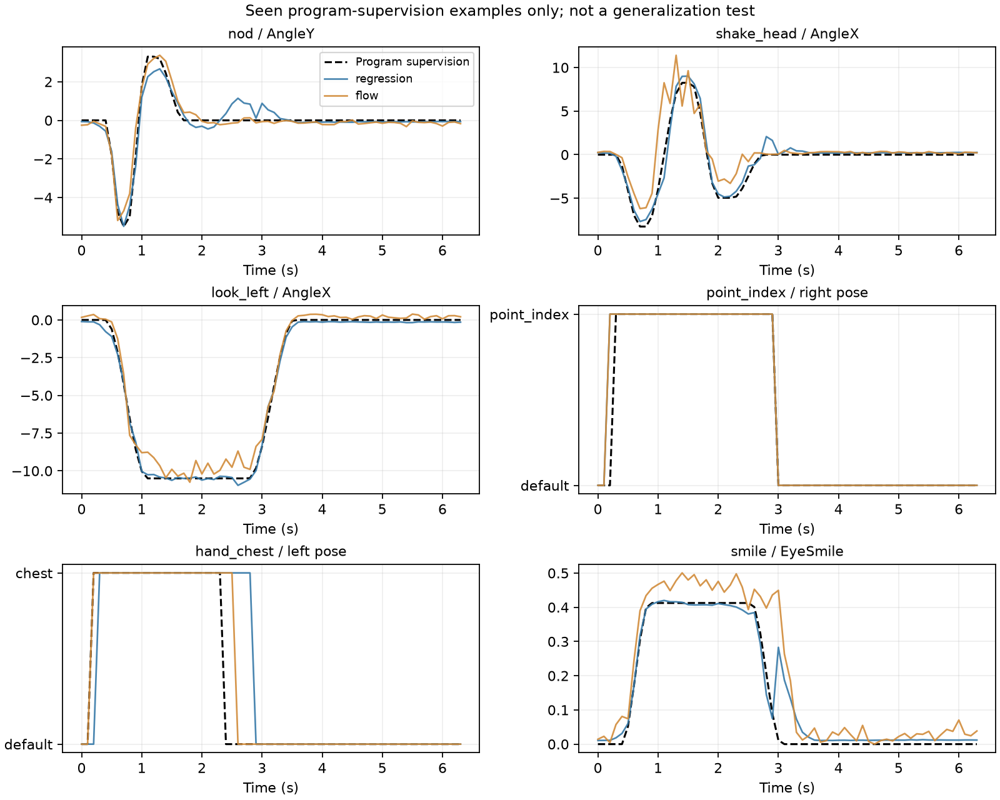
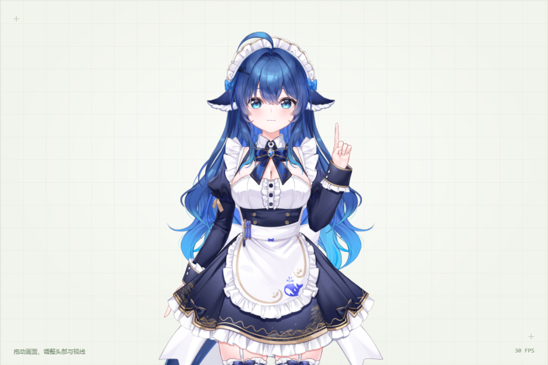

# 冻结语义特征 → 连续动作：首轮实验

日期：2026-10-31。结论：链路已完成真实训练，并通过角色物理、网格、手势、录制回放及网页操作验证。默认选择活跃帧平衡损失的并行预测头。**结论仅限未审核程序样本的训练拟合，尚无独立语言泛化证据。**

## 实验设置

固定 Qwen/Qwen3.5-0.8B revision `2fc06364715b967f1860aea9cf38778875588b17`，语言骨干全冻结。输入为台词、语境、风格，最后 16 个 token 的 1024 维隐状态通过 cross attention 条件化动作专家；不会把旧动作标签、强度、指令日志或样本 ID 输入编码器。

动作专家：2 层、宽 128，17 维初始控制/手势状态。并行回归头 **706,449** 个参数；Flow 头 **726,801** 个参数。输出 64×12 连续控制值及左右手逐步分类。Flow 使用线性噪声桥训练速度场、8 步 Euler 推理，没有显式动作 VAE。手臂的进出动画仍由角色原有动画执行。

100 条 `program_authored_unreviewed` 候选全部用于训练，独立来源组只有 1，未做会造成共享程序来源泄漏的随机测试拆分。数据指纹 `196897fc2b29c50735b5998059e8ae1049bde85f72d8824c9cf6a40852e7ccef`。训练目标为物理前驱动，10 Hz，结束后补末值；归一化采用固定通道范围。8 轴有动作监督，另 4 轴未覆盖。

seed=41，batch=24，AdamW lr=8e-4。训练环境：WSL Ubuntu-24.04、Python 3.12、PyTorch 2.10.0+cu128、RTX 5070 Ti 16 GB。训练使用缓存冻结特征，因此不将编码器加载/提特征时间算作头部训练耗时。

## 对照与失败发现

最初回归基线的全轴平均误差较低，但图像检查发现短点头被压低、笑眼和前倾接近静止；大部分静止元素掩盖了失败。保留原始权重，并补做相同步数对照。新损失按每轴活跃元素归一化，同时保留 0.25 倍静止区误差；速度和手势损失不变。

下面从同一缓存、同一推理设置重算。误差均为固定 profile 映射到 [-1,1] 后的 MAE；活跃定义为偏离中性值 >0.03，并排除补齐帧。全部是训练样本，不是测试集分数。

| 实验 | 回归/Flow 步数 | 回归活跃 MAE | Flow 活跃 MAE | 回归有效全轴 MAE | Flow 有效全轴 MAE |
| --- | ---: | ---: | ---: | ---: | ---: |
| 初始 baseline | 1200 / 1800 | 0.23229 | 0.06896 | 0.01864 | 0.01255 |
| 原损失、匹配预算 | 2000 / 3000 | 0.20719 | 0.05059 | 0.01510 | 0.01161 |
| 活跃帧平衡 | 2000 / 3000 | **0.02572** | 0.06682 | 0.02332 | 0.01967 |

平衡损失明显改善了本 seed 的回归动作幅度拟合，但静止区误差和一阶差分误差上升，曲线仍有小幅多余动作。它没有改善 Flow 的活跃 MAE，不能声称这一修改普遍更好。并行头更快、无原始越界，因此作为当前默认；Flow 保留用于后续真实数据实验。

平衡回归的语义特征打乱后，活跃 MAE 从 0.02572 升至 0.48168；完全中性预测为 0.49439。这说明网络使用了条件特征，但不能区分记忆与对未见语义的泛化。左右手超过 99% 的逐帧准确率包含大量默认帧，也不能当作手势级泛化得分。

Flow 原始输出：平衡组 6.80% 元素越界，归一化超界量全元素平均 0.00141、最大 0.09077；执行前显式限幅，统计随 API 返回。回归 tanh 输出原始越界为零。手势只做最短 2 帧、最短切换间隔 1.3 秒的执行编排，不用规则选择语义动作。

## 推理延迟与实际执行

六个已见短句，每句各头预热一次后测量 5 次。平衡组编码器中位数约 **27～29 ms**，并行头 **1.4～1.7 ms**，8 步 Flow 头 **10.0～10.6 ms**。这是 CUDA 同步后的本地计算延迟，不含网络、浏览器下一帧或整段动画播放。首次请求有冷启动开销，最终受管理重启后的首个请求约 771 ms（见 cold-prediction.json），不能用预热时间代表冷启动。

浏览器验证读取真实参数与网格：并行头点头峰值驱动 AngleY=-5.4898，原生物理输出 ParamAngleY=-5.7593；笑眼 EyeSmile=0.41995；竖食指 Movement3=1；抚胸 Movement2=1。Flow 点头也产生真实物理与网格变化。截图经查看，角色正常渲染；本轮未做人工逐动作自然度评分。

生成轨迹录制保留检查点来源并可回放，正在录制时便捷表演接口拒绝复位。还验证了短期预测只执行一次、可见网页预测/表演操作、390px 手机宽度，以及旧研究/策略 API 已退出。

详细证据：

- [统一指标](comparison.json)：三组、双头、逐轴活跃误差、条件打乱和越界量。
- 每组的 `run.json` / `dataset.json` / `source/`：配置、训练日志摘要、检查点哈希和当时源码；`.pt` 为实际训练权重。
- 每组的 `evaluation.json` / `predictions.json`：短句延迟与完整预测，不含独立测试结论。
- [连续动作浏览器验证](activity-balanced/browser-verification.json)：实际参数、网格差异、测试项目与截图。
- [完整基础角色回归验证](core-browser-verification.json)，包括全部 23 表情、8 动画、原生物理、录制回放和外部控制。
- [受管理重启后的首次预测](activity-balanced/cold-prediction.json)，保存请求、来源与首次前向的实际计算延迟。

## 下一步

优先保持这一小型并行头作为基线，补真实表演监督，再判断 Flow 是否值得增加复杂度。

1. 先录制并人工审核 200～500 条短片段，覆盖缺失通道、同一句在不同语境的动作差异、默认/非默认初始姿态及动作衔接；程序候选和模型生成片段保留来源标签。
2. 将会话、台词改写族和动作来源连通分组，锁定独立测试集，再做去重与训练；程序预训练与人工微调分别报告。
3. 保留中性、特征打乱、并行回归和 Flow 对照，加入盲评、峰值幅度、手势片段 F1、静止漂移、速度/加速度与跨段连续性指标。
4. 若数据支持一语多动，再训练条件 Flow 或动作 VAE；有非默认状态监督后再增加滚动动作块控制。当前尚未接入音频或上游实时 LLM。

