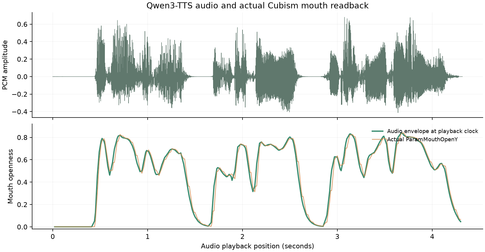

# Qwen3-TTS 与 Live2D 语音闭环 v1

已连接用户训练好的 1.7B CustomVoice checkpoint，音色 `da_fei_yu`。台词经 TTS 合成整句音频，同时取得原有 VTuber v3 身体动作；浏览器按 AudioContext 时钟播放，实际波形的 60 Hz 能量曲线驱动嘴部开合。

## 实际测量

测试台词：**大家晚上好，我是大肥鱼。很高兴又见到你。**

| 项目 | 结果 |
| --- | --- |
| 实际音频 | 4.32 秒 / 24000 Hz PCM16 |
| 本次合成耗时 | 5.94 秒 |
| 实际嘴部参数与播放时钟下口型包络的相关系数 | 0.9881 |
| 嘴部参数平均绝对偏差（参数范围 0～1） | 0.0279 |
| 原有神经动作播放案例 | 25/25 通过 |
| 原始控制、录制回放和外部调用回归 | 通过；回放参数最大误差 0 |

该相关系数验证的是**预定能量包络到真实 Cubism 嘴部参数的执行同步**，不是音素口型准确率或语音识别准确率。尚未进行逐音素或主观听感评估。嘴部截图与实际网格也已检查，张开/闭合可见。

[示例语音](sample.wav) · [口型、来源与音频哈希](sample.json) · [逐帧浏览器检查](speech-verification.json)

## 已验证行为

- 浏览器声音未启用时返回明确错误，启用后能重试同一个准备 ID；成功播放后 ID 消耗一次。
- 实际音频驱动可覆盖动作模型的中性闭嘴输出，语义嘴形继续保留。
- 声音与动作一起暂停/续播；播放结束闭嘴，四项基础行为保持开启。
- 仅语音模式保留当前表情/姿态；停止和复位能取消播放。
- 音频尚在获取/解码时取消，或合成期间点击停止，均不会迟到自动出声。
- 页面“说话并表演”、停止按钮和移动端布局通过。

## 接口与启动

双击根目录 `start.cmd`，打开 `http://127.0.0.1:8765/?speech=1#latent-panel`，输入台词后点击 **说话并表演**。外部 LLM 使用 `/api/speech/prepare` → `/api/speech/execute`；先在页面启用一次声音。示例脚本为 `examples/speak_demo.py`。根 `stop.ps1` 同时关闭 Node、动作专家和 TTS。

配置和工作方式见 [speech/README.md](../../speech/README.md)，接口见 [docs/api.md](../../docs/api.md)。TTS 复用原训练环境（Torch 2.7.0 / Transformers 4.57.3），与动作模型环境分开，避免依赖冲突。用户模型保持原位引用，未复制多份权重。

## 当前边界

当前先合成整句再播放，非流式生成。口型是音频能量驱动的开合，尚无 A/I/U/E/O、唇齿音等音素级形状。身体轨迹保留自己的 6.4 秒或原生动作时长，长语音继续使用常驻待机。当前记录只作工程验证，未加入任何动作训练集；原有冻结数据与动作模型哈希已复核。

TTS 权重 SHA-256：`b62a26f6c2ebd10582c088c318d1fe045f19861500caf7eae300b676d2f19a3d`。音频 SHA-256：`26dc7b044ae0e6d21d97f33d62fd3f60dfcbf676e02089ced9ddf3162186ffa8`。
