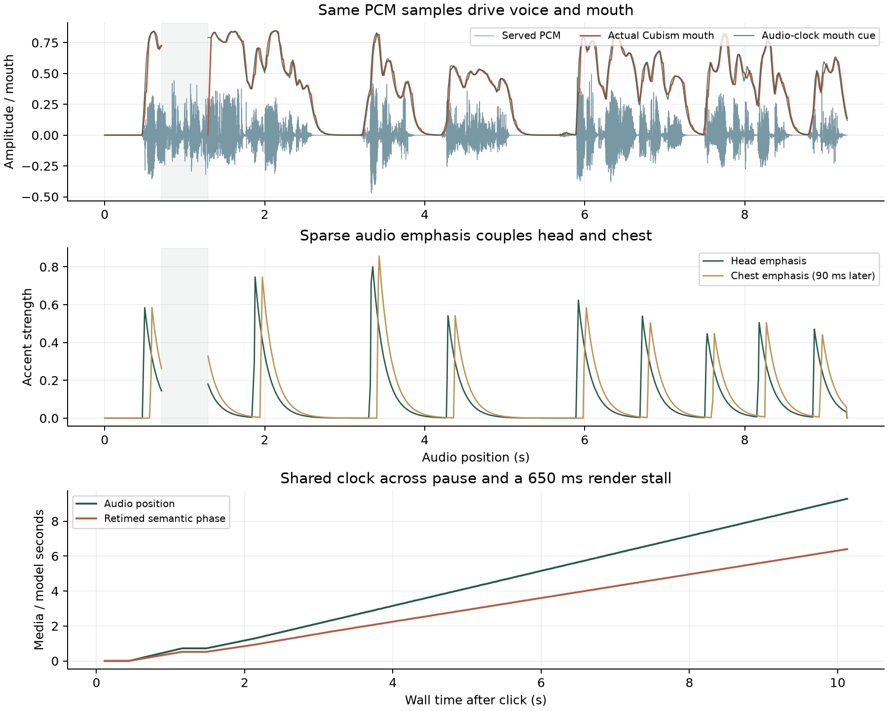

# 语音响应与动作联动 v2

使用原有 da_fei_yu / checkpoint-best 与 VTuber v3 动作专家。新增 CUDA Graph 推理、流式 PCM 播放、动作与语音并行准备、统一媒体时钟和小幅语音重音联动。未重新训练，也未改动训练项目、原始角色、冻结数据或动作检查点。

## 实测

本机 RTX 5070 Ti，CUDA，Qwen3-TTS 1.7B，Torch 2.7.0+cu128 / Transformers 4.57.3。旧完整接口基线为同机同句的一次已有热服务测量，加速完整接口为两次独立服务测量；流式 worker 为两句各三次，浏览器为一次完整记录。不是跨硬件基准或主观自然度评分。

| 测量 | 结果 |
| --- | --- |
| 同一句原完整合成（语音 4.32 秒） | 5.882 秒 |
| 同一句 CUDA Graph 完整合成 | 1.377 秒；约 4.27 倍 |
| 热 worker 首 PCM，6 次 | 0.256～0.295 秒；中位 0.279 秒 |
| 浏览器点击到实际音频时钟起播 | 0.436 秒 |
| 浏览器点击到实际嘴部开度超过 0.12 | 0.935 秒 |
| 该浏览器样例语音 / 全部生成耗时 | 9.28 / 3.403 秒 |
| 音频开始播放时仍在生成 | True |
| 真实 TTS 播放缓冲不足 | 0 次 |
| 预定口型到实际 Cubism 嘴部参数相关系数 | 0.9812 |
| 已有动作与可见配置回归 | 25/25 通过 |
| 冻结 v2/v3 数据与动作实验逐文件校验 | 全部通过 |
| 真实 Ctrl+C 与最后一次测试关闭 | 进程、端口全部释放 |

首 PCM、AudioContext 起播、嘴部出现有声开合是不同测量。模型音频带有前导安静段；没有将它们混称为首个有声音节的延迟。嘴部阈值是实际模型参数的代理，并非人工听感计时。口型相关系数仅验证执行同步，不代表音素准确率。

## 动作如何配合语音

语义专家仍根据整句台词/语境生成连续轨迹与表情、手势配置。生成轨迹按音频总长度重定时；最终长度尚未知时预留结束区，得到真实样本数后从当前进度继续对齐，不倒退。语音较长时身体继续表演。完整原始脱捕保持原速，可以在短台词结束后继续完成。

实际 PCM 产生因果能量、开合与稀疏重音；小幅点头与晚 90 ms 的躯干重音联动。两次强调至少间隔 550 ms，手势与表情不由音量切换。停顿时重音衰减，呼吸、眨眼、待机和物理继续运行。暂停、缓冲不足时媒体进度保持；渲染卡顿后身体相位从音频时钟恢复。

这是语义动作加音频节奏层，尚未训练音频条件动作网络，也没有逐词强制对齐或音素级口型。若要学习“哪个词对应哪个动作”，下一步需要带语音时间戳的文本—音频—动作监督，按说话人/台词族隔离评估。

灰区是测试中刻意阻塞渲染产生的无逐帧采样窗口，曲线在此留空；声音继续播放，恢复绘制后重新按媒体位置采样。它不表示卡顿期间画面仍能更新。

[实际流式语音](sample.wav) · [波形与推理来源](sample.json) · [逐帧浏览器验证](stream-verification.json) · [完整接口回归](legacy-verification.json) · [流式测量](stream-benchmark.json)

## 验证范围

真实模型与 Cubism 检查覆盖：首段播放时继续生成；零真实断流；长句动作伸展；头/躯干重音；暂停/续播；650 ms 渲染阻塞后的时钟恢复；仅语音保留黑脸和情绪嘴形；取消真实解码；并发拒绝；迟到分块隔离；缺失/重复样本拒绝；故意缓冲不足后的续播；外部 Python 调用和移动端。另有单元检查覆盖动作专家失败时取消并行 TTS、流截断后的清理与无效协议。所有数据/动作检查点校验通过。

6 次流式测量逐样本验证传输 PCM 与最终 WAV 完全一致。分块边界跃变未高于各波形通常的 99 分位跳变；这是数值检查，不替代人工试听或音色相似度/自然度评分。

停止路径另外复现并修复了 Windows 保留已退出进程句柄时的误报：创建时间继续用于核对身份，额外读取退出状态区分已结束进程。已用保留 Popen 句柄的单元复现、完整 `--stop` 路径和真实 Ctrl+C 验证。[Windows 退出状态接口](https://learn.microsoft.com/en-us/windows/win32/api/processthreadsapi/nf-processthreadsapi-getexitcodeprocess)

## 运行与复现

`python main.py` 启动全部服务，模型和解码器预热后报告就绪；按 Ctrl+C 全部关闭。页面刷新到新版本后，点击“说话并表演”。外部 LLM 可调用 `/api/speech/perform`，或运行 `python examples/speak_demo.py --text "你好，我是大肥鱼。"`。原 prepare/execute 接口继续可用。

`npm test`、`npm run check`、`npm run test:speech`、`npm run test:speech:stream`；动作回归为 `npm run test:latent`。流式测量脚本 `scripts/speech/benchmark_stream.py`；独立完整合成比较 `scripts/speech/benchmark.py --backend huggingface|cuda_graph`，需先关闭已有 TTS。

加速源码：[https://github.com/andimarafioti/faster-qwen3-tts](https://github.com/andimarafioti/faster-qwen3-tts)，版本 0.3.2，commit `b84dc773b2199a85cb421eb76857e4475e03e8c4`，MIT。固定源码与逐文件哈希见 source/vendor/faster-qwen3-tts/SOURCE.json；保留现有 Transformers 4.57.3 环境，未安装替换训练依赖。CPU 完整推理回退路径保留，未测试其性能。

TTS 权重 SHA-256：`b62a26f6c2ebd10582c088c318d1fe045f19861500caf7eae300b676d2f19a3d`。样例 WAV SHA-256：`3e0d48c9829e7927a18dab249826345c51e4e11dd5795e983121ad4d699f5ec6`。当前测试未加入动作训练集。旧 experiments/speech-v1/ 保持封存；本目录的 source/ 是交付时源码快照，不是新入口。
