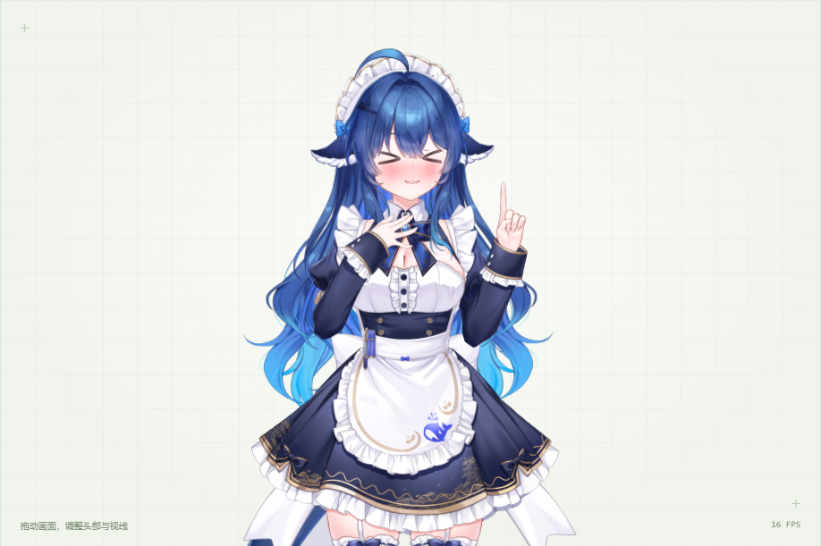
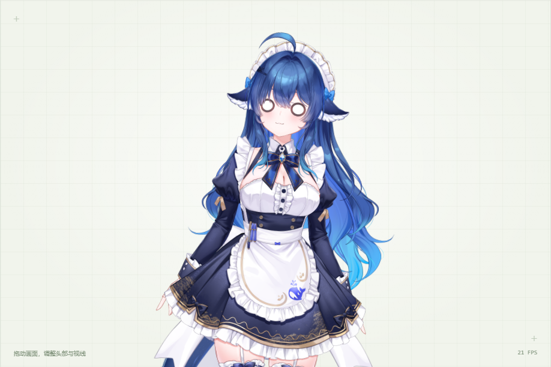

# VTuber v2：联动、躯干幅度与原生表情学习

日期：2026-10-31。当前默认模型已更新为本版并行头；Flow 可切换对照。真实浏览器验证确认神经预测同时驱动躯干、头部、手势和原生表情开关，结束后关闭表情。

## 数据与审核

160 段×6.4 秒，20 个动作族，每族 8 个变体，独立动作时长约 17.1 分钟。原始 320 个字幕配对去掉 100 个完全重复输入，保留 220 个配对：训练 176、验证 22、测试 22。动作族和改写一起拆分，同族速度/幅度变体不跨集。

来源为程序编排，参考原始“脱捕”的相关运动纹理，在原生 Cubism 运行时录制。助手检查全部 20 张分镜，覆盖每段六个实际渲染时刻，并额外核对单眼眨眼和后段表情帧；160/160 通过数值与分镜审核。没有真人表演或真人自然度打分。

数据 SHA-256：`cb328b22390c1b60793816383f16c394c34bd3e87327742ef5c71d5ff1a46a09`。
profile SHA-256：`41bd84038b72a62200b35b8bf1d82bad226d0068744c9791d24b49e49eb85103`。

[完整性审计](../../datasets/vtuber-v2/review/integrity.json) 还检查了全部 509 个原生参数，共 10,424,320 个驱动/实际数值；全部有限，录制与准入样本一致，未发现重复编码输入或完全相同的动作跨拆分。

## 本轮变化

- 从 12 轴扩展为 16 轴，补眼睑和嘴形；原来未被有效监督的躯干 XYZ 和垂直视线现在有训练覆盖。
- 在克制版基础上，头部水平/俯仰乘 1.65、歪头乘 1.9、躯干 XYZ 乘 5.5、前倾乘 2.15。数值始终位于角色真实边界内，实际躯干摆角明显增加。
- 加入 9 类原始表情：爱心眼、＞＜、屑屑眼、圈圈眼、脸红、兔牙、流冷汗、流泪、加载。保存完整开启/保持/切换/关闭时间；眼型互斥，脸红等可叠加。
- 新增学习到的多标签表情头，用 BCE 与正例权重 4 训练。推理直接读取神经概率，既不按台词关键词选表情，也不检索动作模板。

动作与表情由同一段语义特征条件化。手势调用原生进出动画，表情调用原始 exp3；头发、裙子、尾巴等仍由原生物理联动。

## 训练与数值评估

冻结 Qwen3.5-0.8B revision `2fc06364715b967f1860aea9cf38778875588b17`，16×1024 语义特征；动作专家宽 128、2 层，初始状态 21 维，输出 64 步。并行头 741,534 参数，Flow 头 762,398 参数。seed=41、batch=24、AdamW lr=8e-4、平衡活跃帧损失，表情 BCE 权重 0.3。

并行头训练 2000 步约 18.31 秒，Flow 3000 步约 29.66 秒；这些时间不含冻结特征提取。环境为 RTX 5070 Ti 16 GB、WSL、PyTorch 2.10.0+cu128。检查点 SHA 与往返加载校验保存在 run.json。

以下来自 [按族留出评估](split-evaluation.json)。动作 MAE 是固定 profile 映射至 [-1,1] 后、偏离中性值超过 0.03 的活跃元素误差；表情为正例 micro-F1。

| 拆分 | 配对数 | 并行动作 MAE | Flow 动作 MAE | 并行表情 F1 | Flow 表情 F1 |
| --- | ---: | ---: | ---: | ---: | ---: |
| train | 176 | 0.01326 | 0.03137 | 1.00000 | 1.00000 |
| validation | 22 | 0.18795 | 0.19240 | 0.17695 | 0.21951 |
| test | 22 | 0.13877 | 0.15151 | 0.76477 | 0.74151 |

训练内已拟合表情切换，但新动作族上的泛化明显弱于训练内，尤其验证族。不能把训练 F1=1 宣称为开放语境下可靠选表情；单眼眨眼等验证族动作也没有在训练中出现。验证与测试未参与优化，未为提高这些分数而把它们混回训练。

全部数据共用同一角色资产与编排程序，属于合成动作族留出，不是独立真人动捕测试。下一步应补真人表演与多种编排方式，覆盖同一语义的不同自然动作、非默认初始状态和连续对话衔接。

## 真实执行与网页验证

[浏览器证据](browser/verification.json) 检查了两种神经头、原生躯干物理、表情真实参数的进入/退出、眼型互斥、网格变化、网页预测/执行、160 段数据回放页面、拆分筛选、分镜和手机宽度。

并行头案例的实际躯干摆角峰值：庆祝 4.74°、迷糊 11.74°、狗尾草逗趣 6.43°、感动 3.95°；不同语境幅度不同。9 类表情由网络预测，案例中编译出 6 次表情开关事件；测试确认原生参数确实改变，末尾恢复默认。





预热后的浏览器请求示例：语义编码约 30～34 ms，并行头约 1.9～3.3 ms，Flow 约 12.7 ms；首个请求约 725 ms。这里只是本机 smoke 测量，不是系统延迟基准，不含整段动画播放。

完整原始功能也通过回归：509 参数、147 部件、23 原始表情、8 原始动画、131 组物理、录制/回放与外部 HTTP/WebSocket。证据见 core-browser-verification.json。

## 使用与复现

运行根目录 `start.cmd`。默认活泼风格；可试“成功啦！我们真的做到了！”或“这个规则把我绕晕啦”，并补充语境。它们接近训练语境，适合检查当前链路；新语境效果仍需人工评估。

数据回放：`http://127.0.0.1:8765/dataset/vtuber-v2/review/index.html`。页面标明原始训练数据回放与神经预测的区别。[数据说明](../../datasets/vtuber-v2/README.md) 包含制作与审核来源。

WSL 下执行：

```bash
export UV_PROJECT_ENVIRONMENT=$HOME/.local/share/auto-live2d/latent-venv
uv run --project latent python latent/train.py --output experiments/new-run --steps 2000 --loss balanced
uv run --project latent python latent/evaluate.py --experiment experiments/new-run
uv run --project latent python latent/audit_dataset.py
```

旧克制版保留在 datasets/vtuber-v1 与 experiments/vtuber-v1；身体幅度不足的未准入中间预览已移至 archive/2026-10-31-vtuber-intermediate，不进入当前训练。
