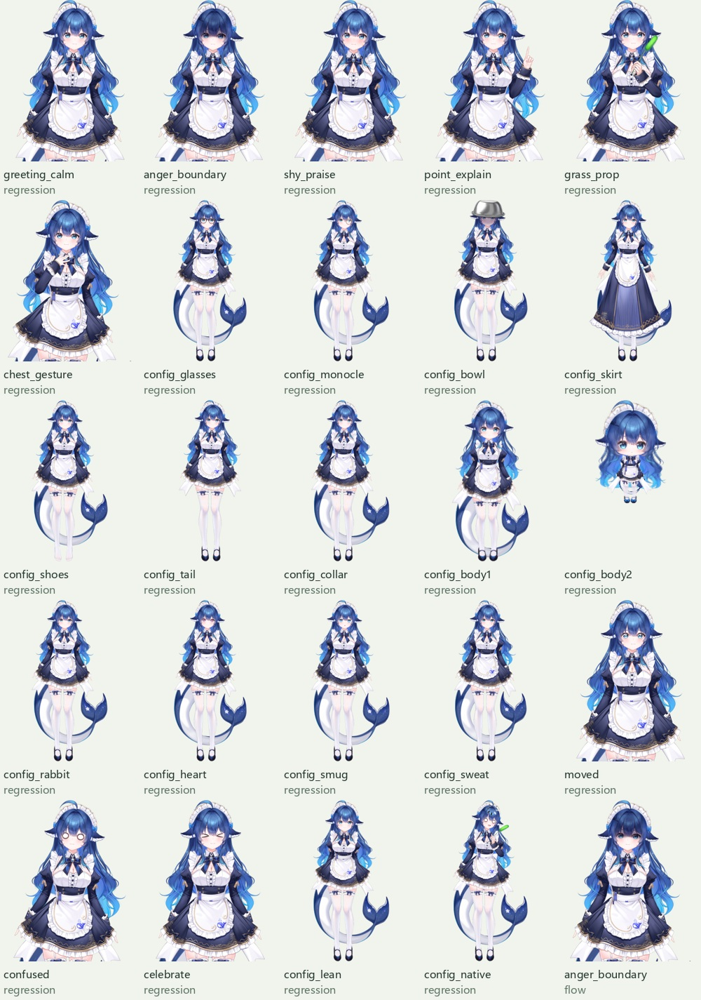

# VTuber v3 实验报告

当前默认模型为冻结 Qwen3.5-0.8B 语义骨干 + 小型动作专家，已经接入本地 Demo。并行头 792,619 参数，Flow 头 813,483 参数。连续动作由神经网络生成；手势进出和完整脱捕使用已有原生曲线，其选择由分类头学习。

## 数据与行为调整

200 段程序动作、200 组台词配对、44 类编排；176 train / 12 validation / 12 test。全部经真实 Cubism 录制、助手数值与逐组分镜审查，**没有真人自然度评分**。脸红从 70% 降为 9%，黑脸新增 12%；显式手势从 70% 降为 10%，另有两段完整脱捕包含其原生手势。

全部 23 个可见表情/外观选项与 8 个原始动画都有 [实际覆盖证据](../../datasets/vtuber-v3/review/coverage.json)。对应 17 类开关、3 个体型、连续前倾、双手进出和脱捕选择；不声称生成全部 509 个参数。普通开口通道保持中性，尚无音频口型训练。

呼吸、眨眼、IDLE 和物理全部常驻；背景时钟跨动作复位保留。自动眨眼在预测眼睑之后叠加，action_driver 与合成 driver 分开记录，避免重复学习眨眼。

## 训练

联合训练并行 2000 步、Flow 3000 步。训练样本内的检查发现体型二混淆，因此冻结其余权重，只对体型分类器平衡采样加训 200 步；[检查记录](appearance-fit.json) 验证非体型权重不变。随后对训练集中的稀有前倾配置提高采样率，加训连续解码器 1000/1500 步，语义投影和全部分类头不变，见 [记录](motion-fit.json)。两次修正均不使用验证/测试标签。

训练体型分类全帧正确；这些配置只有少量明确指令示例，不能据此推断开放语言泛化。模型选择过程中保留了早期结果，见 [封存对照](../../archive/2026-10-31-vtuber-v3-training-controls/README.md) 和 [路径来源](promotion.json)。

## 数值测量

MAE 使用归一化 [-1,1] 单位，motion-only 仅统计有明显目标偏移的元素。Flow 越界在执行前显式限幅，并随预测报告。

| 拆分 | 模型 | 全轴 MAE | 动作元素 MAE | 表情正类 F1 | 原始越界占比 |
| --- | --- | ---: | ---: | ---: | ---: |
| train | regression | 0.0081 | 0.0098 | 0.9997 | 0.00% |
| train | flow | 0.0126 | 0.0172 | 0.9972 | 6.32% |
| validation | regression | 0.0442 | 0.0767 | 0.9438 | 0.00% |
| validation | flow | 0.0520 | 0.0916 | 0.9471 | 6.67% |
| test | regression | 0.0332 | 0.0554 | 0.9726 | 0.00% |
| test | flow | 0.0347 | 0.0558 | 0.9829 | 5.97% |

留出集仍来自同一编排程序和角色资产：validation 为生气与羞涩，test 为生气拒绝与普通感谢；没有正向手势、服装或体型目标。相同安静轨迹的所有语义组在划分前放进 train，跨拆分相同轨迹为零。不能把上述 F1 当作全部配置或真人动作的泛化指标。

20 条预先设定、开发期间可见的行为回归案例，**不是独立泛化测试**：

| 行为 | 非目标语境误触发（v2 → v3） | 目标语境检出（v2 → v3） |
| --- | --- | --- |
| 脸红 | 12/18 → 0/18 | 2/2 → 2/2 |
| 黑脸 | 0/16 → 0/16 | 0/4 → 4/4 |
| 手势 | 13/18 → 0/18 | 2/2 → 2/2 |

原始结果：[之前](behavior-before.json)、[当前实际服务](behavior-after.json)、[全拆分](split-evaluation.json)。

## 实际播放验证

25 个神经预测播放案例通过实际 Cubism 参数读回与网格检查，包括全部 17 类开关、两种非默认体型、前倾、双手手势、完整 13.8 秒原始脱捕，以及 Flow 生气案例。另验证四项基础行为持续变化、自动眨眼不受睁眼目标压制、背景相位保持、表达退出、预测 ID 仅消费一次，以及 200 段/44 类图库的筛选、分镜和移动端布局。

见 [浏览器记录](browser/verification.json) 和下列实际神经预测渲染。它们不是数据回放。

拼图按透明轮廓裁剪排版，便于看清效果；原始全尺寸帧保留在 browser 目录，体型的实际尺寸关系可查看数据分镜。

控制接口另检查全部 23 个原始表情、8 个动画、509 个参数的边界、原生物理、固定步长录制回放、HTTP/WebSocket 客户端。前端类型检查、9 个控制单测和 10 个 Python 测试通过。完整性与归档哈希另保留在各目录的清单中。

## 边界与下一步

当前从默认动作状态开始，未训练跨句动作衔接；背景行为持续。没有音频观测、视觉闭环或真人表演监督。下一阶段应收集真人对语义、自然度、手势频率的评分，以及配置切换的更多措辞和三种风格组合，建立独立正向手势/外观测试，再开展滚动动作块训练。

数据指纹：`2e18fa16e32a98669d67d5ce2cb0081eba1030db6d6b59176595b8c146587808`。Profile：`12584dec9c5c23dbb739796e57ded00cade3fb94067720d17b77ca7c7c289485`。权重 SHA-256 见 run.json。
